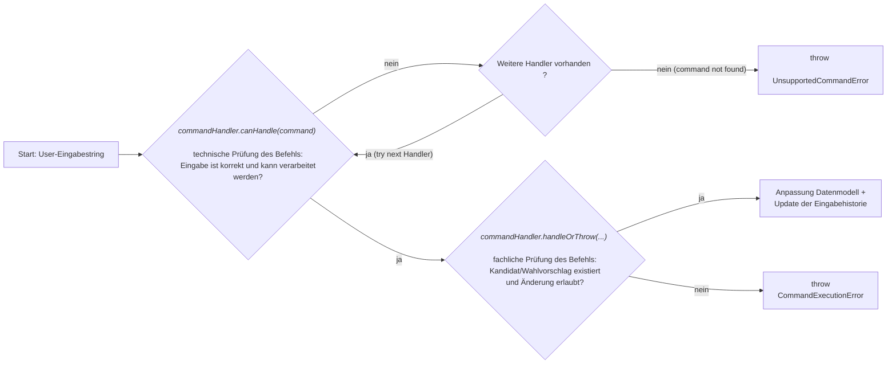

# Kurzbefehle für die Erfassung {#kurzbefehle-fur-die-erfassung}

Um eine schnelle Erfassung der Daten des Stimmzettels zu ermöglichen, können Befehle eingegeben werden.

## Überblick Befehle

| Befehl                              | Funktion                                                                                                                                                            | Beispiel  |
|-------------------------------------|---------------------------------------------------------------------------------------------------------------------------------------------------------------------|-----------|
| **Einzelstimmen**                   |                                                                                                                                                                     |           |
| `<Kandidatenordnungszahl>`          | Fügt eine Stimme bei der kandidierenden Person mit der `Ordnungszahl` hinzu                                                                                         | 101       |
| `<Kandidatenordnungszahl>+`         | Fügt eine Stimme bei der kandidierenden Person mit der `Ordnungszahl` hinzu                                                                                         | 101+      |
| `<Kandidatenordnungszahl>+<n>`      | Fügt `n` Stimmen bei der kandidierenden Person mit der `Ordnungszahl` hinzu                                                                                         | 101+3     |
| `<Kandidatenordnungszahl>-`         | Entfernt eine Stimme bei der kandidierenden Person mit der `Ordnungszahl`                                                                                           | 101-      |
| `<Kandidatenordnungszahl>-<n>`      | Entfernt `n` Stimmen bei der kandidierenden Person mit der `Ordnungszahl`                                                                                           | 101-3     |
| `[u/U]<Kandidatenordnungszahl>`     | Fügt 1 ungültige Stimme bei der kandidierenden Person mit der `Ordnungszahl` hinzu                                                                                  | u101      |
| `[u/U]<Kandidatenordnungszahl>+<n>` | Fügt `n` ungültige Stimmen bei der kandidierenden Person mit der `Ordnungszahl` hinzu                                                                               | u101+3    |
| `[u/U]<Kandidatenordnungszahl>-`    | Entfernt 1 ungültige Stimme bei der kandidierenden Person mit der `Ordnungszahl`                                                                                    | u101-     |
| `[u/U]<Kandidatenordnungszahl>-<n>` | Entfernt `n` ungültige Stimmen bei der kandidierenden Person mit der `Ordnungszahl`                                                                                 | u101-3    |
| `<untere>-<obere>`                  | Fügt je 1 Stimme bei allen kandidierenden Personen im Bereich der `Ordnungszahl` von `untere`–`obere` hinzu                                                         | 501-510   |
| `<untere>-<obere>+<n>`              | Fügt je `n` Stimmen im Bereich der `Ordnungszahl` von `untere`–`obere` hinzu                                                                                        | 527-535+2 |
| **Listenkreuze**                    |                                                                                                                                                                     |           |
| `<Wahlvorschlagsnummer>`            | Kennzeichnet den Wahlvorschlag mit der `Ordnungszahl` (Die Eingabe erfolgt entweder als Wahlvorschlagsnummer oder als Ordnungszahl mit „00“ am Ende)                | 5, 500    |
| `<Wahlvorschlagsnummer>-`           | Entfernt die Kennzeichnung des Wahlvorschlags mit der `Ordnungszahl` (Die Eingabe erfolgt entweder als Wahlvorschlagsnummer oder als Ordnungszahl mit „00“ am Ende) | 5-, 500-  |
| **Streichungen**                    |                                                                                                                                                                     |           |
| `[s/S]<Kandidatenordnungszahl>`     | Streichung für die kandidierenden Person mit der `Ordnungszahl`                                                                                                     | s501      |
| `[s/S]<untere>-<obere>`             | Streichungen für alle kandidierenden Personen im Bereich der `Ordnungszahl` von `untere`–`obere`                                                                    | s501-509  |
| `[s/S]<Kandidatenordnungszahl>-`    | Streichung für die kandidierenden Person mit der `Ordnungszahl` wird zurückgenommen                                                                                 | s501-     |
| `[s/S]<untere>-<obere>-`            | Streichungen für alle kandidierenden Personen im Bereich der `Ordnungszahl` von `untere`–`obere` werden zurückgenommen                                              | s501-509- |

## Ausführliche Beschreibung

### Eingabeformat und allgemeine Regeln

Ein Befehl wird ohne Leerzeichen eingegeben und durch die Betätigung der `Enter`-Taste ausgeführt. Bei `u` für
ungültige Stimmen und `s` für Streichungen spielt die Groß- und Kleinschreibung keine Rolle.

- `<Kandidatenordnungszahl>` ist die auf dem Stimmzettel angegebene Ordnungszahl einer kandidierenden Person, zum
  Beispiel `101`. Im Folgenden ist sie mit der `Listenposition` gleichzusetzen.
- `<Wahlvorschlagsnummer>` ist die Nummer eines Wahlvorschlags, zum Beispiel `5`. Alternativ kann die zugehörige
  Ordnungszahl mit zwei Nullen verwendet werden, in diesem Fall `500`.
- `<n>` ist eine positive ganze Zahl. Fehlt die Anzahl bei einem `+` oder `-`, geht das System automatisch von
  einer `1` aus. Dementsprechend haben beispielsweise `101` und `101+` dieselbe Wirkung.
- Ein Bereich enthält die untere und obere Grenze: `501-510` betrifft die Kandidatenordnungszahlen 501 bis
  einschließlich 510. Die Reihenfolge der Grenzen ist unerheblich, daher wirkt `510-501` genauso wie `501-510`.

### Kandidat\*innenstimmen

#### Einzelstimmen

Für Befehle zu einzelnen kandidierenden Personen muss die angegebene Kandidatenordnungszahl auf dem Stimmzettel vorhanden
sein. Beim Entfernen von Stimmen muss die Menge der zu entfernenden Stimmen bereits vergeben worden sein.

Überschreitet die eingegebene Stimmenzahl die für eine kandidierende Person zulässige Höchstzahl, wird der Befehl nicht abgelehnt.
Das System erfasst den zulässigen Anteil als gültige Einzelstimmen und den darüber hinausgehenden Anteil als
ungültige Stimmen. Alternativ können ungültige Stimmen auch manuell erfasst werden.

Beim Entfernen gültiger Stimmen wird dabei die Summe der gültigen und ungültigen Stimmen der ausgewählten Nennung
berücksichtigt. Das System entfernt zuerst vorhandene ungültige Stimmen und danach gültige Einzelstimmen. Ungültige Stimmen
können nur entfernt werden, wenn mindestens die angegebene Menge an ungültigen Stimmen vorhanden ist.

Beispiele

> [!NOTE] Ergänzen von Einzelstimmen
> Bei einer Wahl dürfen für jede kandidierende Person maximal 3 Stimmen vergeben werden. Der/die Wähler\*in hat eine 5 bei
> einer kandidierenden Person eingetragen.
>
> Es wurden 5 Stimmen vergeben, davon sind 3 gültig und 2 vom System automatisch als ungültig erkannt.

> [!NOTE] Entfernen von Einzelstimmen
> Bei einer Wahl dürfen für jede kandidierende Person maximal 3 Stimmen vergeben werden. Der/die Wähler\*in hat eine 5 bei
> einer kandidierenden Person eingetragen und möchte nun 3 davon wieder entfernen.
>
> Es sind 3 gültige und 2 ungültige Stimmen vorhanden. Nach der Entfernung von 3 Stimmen, angefangen bei den
> ungültigen, sind noch 2 gültige Stimmen übrig.

#### Streichungen

Eine Streichung kann nur gesetzt werden, wenn mindestens eine Nennung der gewählten kandidierenden Person noch nicht
gestrichen ist. Sie kann nur zurückgenommen werden, wenn eine Streichung vorhanden ist. Wird eine Streichung gesetzt,
werden bereits erfasste gültige Einzelstimmen dieser Nennung zu ungültigen Stimmen. Ebenso werden Stimmen, die zu einer
bereits gestrichenen Nennung hinzugefügt werden, als ungültige Stimmen erfasst.

Beispiele

> [!NOTE] Ergänzen einer Streichung, obwohl Stimmen vergeben wurden
> Es gibt kandidierende Personen mit den Listenpositionen 1 bis 10. Die Position 2 hat bereits 3 Einzelstimmen. Der/die
> Wähler\*in vergibt nun eine Streichung für diese Position.
>
> Die zuvor gültigen Stimmen werden vom System automatisch als 3 ungültige Stimmen erkannt und die kandidierende Person
> ist gestrichen.

> [!IMPORTANT] Entfernen einer Streichung wandelt ungültige Stimmen nicht in gültige um
> Wenn eine kandidierende Person mit 3 Einzelstimmen gestrichen wird, werden diese gültigen Stimmen in ungültige
> umgewandelt. Wird die Streichung nun wieder entfernt bleiben die Stimmen ungültig und müssen ggf. manuell wieder
> zu gültigen gemacht werden.

#### Bereiche

Ein Bereich kann nur Kandidatenordnungszahlen eines Wahlvorschlags enthalten. Für einen Bereich müssen alle
Ordnungszahlen zwischen unterer und oberer Grenze auf dem Stimmzettel vorhanden sein. Fehlt auch nur eine
Ordnungszahl oder umfasst der Bereich mehrere Wahlvorschläge, wird der gesamte Befehl abgelehnt. Ein Stimmenbereich kann
außerdem nur ausgeführt werden, wenn keine darin enthaltene Nennung gestrichen ist. Bereits erfasste Stimmen bleiben
dabei unverändert, beziehungsweise werden durch die Bereichsstimmen ergänzt.

Beispiele

> [!NOTE] Ungültiger Bereich über Grenze hinweg
> Ein Wahlvorschlag enthält die Kandidatenordnungszahlen 501 bis 505.
>
> Der Befehl 501-510 wird abgelehnt, weil die Ordnungszahlen 506 bis 510 nicht existieren.

> [!NOTE] Ungültiger Bereich über Wahlvorschläge hinweg
> Es existieren die Wahlvorschläge mit den Ordnungszahlen 100 und 200.
>
> Der Befehl 101-201 wird abgelehnt, weil die Ordnungszahlen 101 und 201 zu unterschiedlichen
> Wahlvorschlägen gehören.

> [!NOTE] Ungültiger Bereich, weil Streichung vorhanden
> Es gibt die Listenpositionen 1 bis 10. Die Position 2 ist bereits gestrichen worden. Der/die Wähler\*in vergibt
> nun jeweils 2 Stimmen für den Bereich 1-3.
>
> Der Befehl wird abgelehnt.

> [!NOTE] Ergänzen von Bereichsstimmen zu bestehenden Einzelstimmen
> Es gibt die Listenpositionen 1 bis 10. Die Positionen 1 bis 3 und Position 6 haben bereits eine Einzelstimme
> erhalten. Der/die Wähler\*in vergibt nun jeweils 2 Stimmen für den Bereich 1-3.
>
> Die Positionen 1-3 haben nun insgesamt jeweils 3 Stimmen, während Position 6 immer noch 1 Stimme hat.

Bei einem Streichungsbereich dürfen einzelne Nennungen bereits gestrichen sein: Das System streicht die übrigen
Nennungen. Erst wenn alle Nennungen im Bereich bereits gestrichen sind, wird der Befehl abgelehnt. Entsprechend wird
das Zurücknehmen eines Streichungsbereichs nur abgelehnt, wenn im gesamten Bereich keine Streichung vorhanden ist.

#### Mehrfachnennungen

Ist eine kandidierende Person mehrfach auf dem Stimmzettel genannt, haben diese Nennungen dieselbe
Kandidatenordnungszahl. Bei einem Befehl für eine einzelne Kandidatenordnungszahl wählt das System eine passende
Nennung automatisch aus: beim Hinzufügen von Stimmen werden Nennungen mit bereits vorhandenen Einzelstimmen bevorzugt;
andernfalls wird eine nicht gestrichene Nennung gewählt. Beim Entfernen wird eine Nennung bevorzugt, auf der die zu
entfernenden Stimmen oder die Streichung vorhanden sind. Ein Befehl kann sich immer nur auf eine einzelne Nennung beziehen.

Beispiele

> [!NOTE] Ergänzen von Stimmen
> Es gibt die Listenpositionen 1 bis 10, jeweils in dreifacher Nennung. Die kandidierende Person 102 hat bereits 2 Stimmen bei
> der ersten Nennung und der/die Wähler\*in möchte eine weitere Einzelstimme eintragen.
>
> Die erste Nennung der kandidierenden Person 102 hat jetzt 3 Stimmen.

> [!NOTE] Ergänzen von Stimmen mit vorhandener Streichung
> Es gibt die Listenpositionen 1 bis 10, jeweils in dreifacher Nennung. Die kandidierende Person 102 hat bereits eine Streichung
> bei der ersten Nennung und der/die Wähler\*in möchte eine weitere Einzelstimme eintragen.
>
> Die erste Nennung der kandidierenden Person 102 ist weiterhin gestrichen und die zweite Nennung hat 1 Stimme.
>
> Hinweis: Analog wird bei umgedrehter Ausgangslage bei einer kandidierenden Person mit vorhandenen Stimmen bei Nennung 1 die
> zweite Nennung gestrichen.

Ein Bereichsbefehl betrifft dagegen alle Nennungen jeder enthaltenen Kandidatenordnungszahl.

Beispiele

> [!NOTE] Ergänzen von Bereichsstimmen
> Es gibt die Listenpositionen 1 bis 10, jeweils in zweifacher Nennung. Es dürfen für jede kandidierende Person maximal 3 Stimmen
> vergeben werden. Der/die Wähler\*in vergibt nun jeweils 2 Stimmen für den Bereich 1-3.
>
> Die Positionen 1 bis 3 haben jeweils 2 gültige Stimmen bei der ersten Nennung und eine gültige sowie eine ungültige
> Stimme bei der zweiten Nennung.

> [!NOTE] Ergänzen von Bereichsstimmen zu bestehenden Einzelstimmen
> Es gibt die Listenpositionen 1 bis 10, jeweils in zweifacher Nennung. Es dürfen für jede kandidierende Person maximal 3 Stimmen
> vergeben werden. Die Position 1 hat bereits 2 Einzelstimmen für die erste Nennung erhalten. Der/die Wähler\*in
> vergibt nun jeweils 2 Stimmen für den Bereich 1-3.
>
> Die Position 1 hat nun insgesamt 6 Stimmen, davon sind 3 gültige und eine ungültige bei der ersten Nennung und 2
> ungültige bei der zweiten Nennung.  
> Die Positionen 2 und 3 haben jeweils 2 gültige Stimmen bei der ersten Nennung und eine gültige sowie eine ungültige
> Stimme bei der zweiten Nennung.

> [!IMPORTANT] Entfernen von Stimmen bei Mehrfachnennungen
> Wurden mehreren Nennungen eines/einer Kandidat*in per Bereichsvergabe mit Stimmen versehen, können diese nicht
> ebenso per Bereich wieder entfernt werden. Stattdessen müssen die Stimmen pro Nennung einzeln entfernt werden.
> Dabei fängt das System immer mit der ersten Nennung an, bei welcher Stimmen vergeben wurden.

### Wahlvorschläge

Für das Setzen von einem Listenkreuz muss der angegebene Wahlvorschlag vorhanden sein. Ein Listenkreuz kann nur
gesetzt werden, wenn der Wahlvorschlag noch nicht ausgewählt ist, und nur entfernt werden, wenn er ausgewählt ist.

Wenn bei einem Wahlvorschlag ein Listenkreuz gesetzt wird, werden Stimmen über die sogenannte Reststimmenvergabe verteilt.
Dabei werden die Stimmen der Reihe nach auf die kandidierenden Personen des Wahlvorschlags verteilt,
die sonst noch keine Kennzeichen (Stimmen oder Streichung) erhalten haben.

Grundsätzlich gilt, dass die Vergabe nur erfolgt, wenn eine eindeutige Vergabe möglich ist. Es können nur so viele Stimmen
vergeben werden, wie nicht explizit durch den/die Wähler\*in vergeben wurden. Die Menge der bereits vergebenen
Stimmen ergibt sich aus der Summe der vergebenen Einzelstimmen und sonstigen ungültigen Stimmen.

Beispiele

> [!NOTE] Reststimmenmenge bei vorhandenen Einzelstimmen
> Bei einer Wahl können bis zu 40 Stimmen vergeben werden. Der/die Wähler\*in hat 3 Kreuze bei unterschiedlichen
> kandidierenden Personen gesetzt und bei einem/einer weiteren eine 2 eingetragen.
>
> Somit sind 5 Stimmen vergeben, und für die Reststimmenvergabe stehen noch 35 Stimmen zur Verfügung.

> [!NOTE] Unerlaubterweise wurde eine zusätzliche kandidierende Person ergänzt
> Bei einer Wahl können bis zu 40 Stimmen vergeben werden. Der/die Wähler\*in hat 3 Kreuze bei unterschiedlichen
> kandidierenden Personen gesetzt. Zusätzlich wurde eine weitere kandidierende Person ergänzt mit der Zahl 3 davor.
> Somit sind 6 Stimmen vergeben, wobei 3 gültig sind und 3 ungültig.
>
> Für die Reststimmenvergabe stehen noch 34 Stimmen zur Verfügung.

> [!NOTE] Reststimmenmenge bei zu vielen Einzelstimmen bei einer kandidierenden Person
> Bei einer Wahl können bis zu 40 Stimmen vergeben werden. Für jede kandidierende Person dürfen maximal 3 Stimmen vergeben werden.
> Der/die Wähler\*in hat bei einer kandidierenden Person eine 5 eingetragen.
> Somit sind 5 Stimmen vergeben, wobei 3 gültig sind und 2 ungültig.
>
> Für die Reststimmenvergabe stehen noch 35 Stimmen zur Verfügung.

> [!NOTE] Keine Reststimmenvergabe möglich
> Bei einer Wahl können bis zu 40 Stimmen vergeben werden. Der/die Wähler\*in hat bei 2 Wahlvorschlägen jeweils das
> Listenkreuz gesetzt. Je Wahlvorschlag gibt es 40 kandidierende Personen.
>
> Es erfolgt keine Reststimmenvergabe: Für eine Reststimmenvergabe wären 80 Stimmen notwendig.
> Somit ist nicht eindeutig erkennbar, wie die Aufteilung der 40 Stimmen auf die 80 kandidierenden Personen erfolgen soll.

Die Vergabe der Reststimmen erfolgt entsprechend der Listenposition innerhalb des Wahlvorschlags, beginnend bei der ersten
Position. Eine kandidierende Person mit nur einer Nennung kann nur Reststimmen erhalten, wenn er/sie noch keine Stimmen erhalten hat
und er/sie nicht gestrichen wurde. Gibt es für kandidierende Personen mehrere Nennungen, können sie nur Reststimmen bekommen,
wenn sie noch nicht die maximal erlaubte Menge an Stimmen erreicht haben.

Beispiele

> [!NOTE] Reststimmenvergabe bei vorhandener Einzelstimmenvergabe
> Es gibt die Listenpositionen 1 bis 10. Die Positionen 1 bis 3 und Position 6 haben bereits Einzelstimmen erhalten.
>
> Über die Reststimmenvergabe bekommen die Positionen 4, 7, 8, 9 und 10 jeweils eine Reststimme.

> [!NOTE] Reststimmenvergabe bei vorhandener Einzelstimmenvergabe und Streichung
> Es gibt die Listenpositionen 1 bis 10. Die Positionen 1 bis 3 haben bereits Einzelstimmen erhalten. Die Position 6
> wurde gestrichen.
>
> Über die Reststimmenvergabe bekommen die Positionen 4, 7, 8, 9 und 10 jeweils eine Reststimme.

> [!NOTE] Reststimmenvergabe bei vorhandener Mehrfachnennung
> Es gibt die Listenpositionen 1 bis 10, jeweils in dreifacher Nennung. Für jede kandidierende Person dürfen maximal 3 Stimmen vergeben werden.
>
> Die Position 1 hat bei jeder der 3 Nennungen ein Kreuz.
> Die Position 2 hat bei der ersten Nennung eine 2 stehen.  
> Die Position 3 hat bei den ersten beiden Nennungen eine 2 stehen.  
> Bei Position 4 wurde die erste Nennung gestrichen.
>
> Über die Reststimmenvergabe bekommt die Position 1 keine Stimmen, weil für die kandidierenden Person bereits die maximale
> Menge an Stimmen erreicht ist.  
> Die Position 2 bekommt noch eine Reststimme, womit sie das Maximum an Stimmen erreicht.  
> Die Position 3 bekommt keine Reststimmen, weil für die kandidierenden Person bereits die maximale
> Menge an Stimmen überschritten wurde. Eine der 4 Stimmen wird als ungültig gewertet.  
> Die Position 4 bekommt noch 2 Reststimmen. Für die gestrichene Nennung gibt es keine Reststimme.  
> Die restlichen Positionen bekommen jeweils 1 Reststimme pro Nennung.

## Architektur der Eingabeverarbeitung

Ein Befehl wird nur ausgeführt, wenn das Eingabeformat gültig ist und alle fachlichen Bedingungen erfüllt sind. Bei
einem Fehler nimmt das System keine Änderung aufgrund dieses Befehls vor. Die Anwendung gibt Feedback, wenn der
Befehl nicht ausführbar oder falsch war.

### Mögliche Fehler

In folgenden Fällen wird ein eingegebener Befehl abgelehnt und es erfolgt keine Änderung am Stimmzettel:

- Entspricht die Eingabe keinem unterstützten Format, enthält sie Leerzeichen oder verwendet sie keine positive
  ganze Anzahl.
- Existiert die angegebene Ordnungszahl für die kandidierenden Person oder den Wahlvorschlag nicht.
- Ist ein Bereich größer als die vorhandene Kandidat\*innenliste, oder umfasst er mehrere Wahlvorschläge.
- Enthält ein Stimmenbereich mindestens eine gestrichene Nennung.
- Sollen mehr Stimmen entfernt werden, als für die ausgewählte Nennung vorhanden sind.
- Soll ein Listenkreuz erneut gesetzt oder von einem nicht ausgewählten Wahlvorschlag entfernt werden.
- Soll eine Streichung erneut gesetzt oder zurückgenommen werden, obwohl keine Streichung vorhanden ist.
